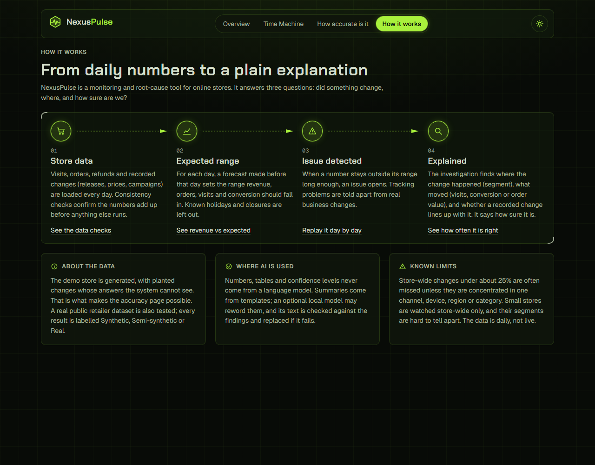
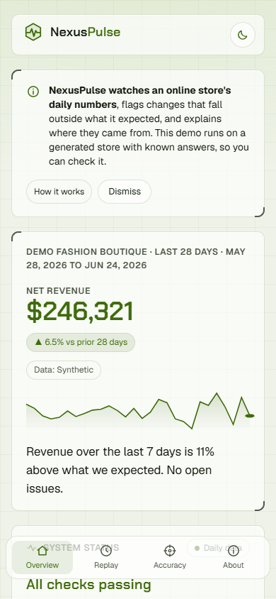

# NexusPulse AI

[](https://github.com/lyle-leif/NexusPulse-AI/actions/workflows/ci.yml)

Business monitoring for small online stores. NexusPulse AI forecasts what each day should look like, flags changes that fall outside it, finds where they happened and what coincided with them, and writes a report in which every sentence cites its evidence. Python computes every number; the optional language model only rewords, runs locally, and is checked against the findings.

**Live demo:** https://lyle-leif.github.io/NexusPulse-AI/ (static and read-only; the full system runs locally)


## What it does

1. **Detects** changes by comparing each day with a forecast made before it, for the whole store and for each channel, device, region and product category large enough to forecast.
2. **Measures** them with an exact revenue bridge and a Shapley breakdown over traffic, the funnel rates, orders per visit and order value.
3. **Locates** them in the segment where they happened, separating traffic changes from rate changes.
4. **Checks what coincided**: releases, price changes and campaigns recorded nearby, holidays, and data-quality problems.
5. **Reports** with typed findings (observed, measured, associated, hypothesis) and an evidence level set by published rules. It never claims a recorded change caused a drop.

## Results

Measured on **held-out** generated stores whose answers the pipeline cannot see, and on a real retailer. Each result is labeled Synthetic, Semi-synthetic or Real.

| | Result |
|---|---|
| Planted changes caught (main store) | 76%, with 0.27 false alerts per 30 days (Synthetic) |
| Right segment / right cause, given the change | 64% / 84% (Synthetic) |
| Cause right when evidence is Strong | 5 of 5 (Synthetic) |
| Real store: daily sales forecast error | 31%, versus 40% for "same day last week" (Real) |
| Real store: expected range held | 94% of days, 0.14 alerts per 30 days (Real) |

<details>
<summary>Detailed results</summary>

### Detection (Synthetic, 5 stores per profile, 18 months each)

| Store | Recall | Precision | False alerts per 30 days | Median delay | Forecast band coverage |
|---|---|---|---|---|---|
| Main (about 1,500 sessions/day) | 0.76 | 0.50 | 0.27 | same day | 95% |
| Low volume (about 150 sessions/day) | 0.40 | 0.23 | 0.44 | 1 day | 96% |

Segment monitoring raised main-store recall from 0.48 to 0.76 and precision from 0.41 to 0.50, at a cost of 0.03 more false alerts per 30 days. The low-volume store has no segment large enough to forecast, so it is monitored store-wide only. Tracking breakages and unrelated recorded changes were handled correctly in 10 of 10 cases on the main store and 7 of 10 on the low-volume store. Settings were chosen on development seeds; the held-out run was done once.

### Investigation (Synthetic, main store)

| | Given the true incident window | From the monitor's own detections |
|---|---|---|
| Correct primary driver | 88% | 79% |
| Correct segment | 64% | 47% |
| Correct cause, or correctly "none" | 84% | 68% |
| Unrelated recorded change rejected | 4 of 5 | not applicable |

The right column covers the 19 scenarios the monitor caught. The 7 added by segment monitoring are harder to explain, which lowered the driver rate there from 92% to 79%.

### Reports (Synthetic, 25 held-out investigations)

| Narration mode | Passed first try | After one retry | Fell back to template |
|---|---|---|---|
| Template only (default) | 25 | 0 | 0 |
| Local llama3.1:8b | 17 | 5 | 3 |

Every AI-written sentence must cite real findings, match their numbers and signs, and avoid causal or overconfident wording. On 450 misleading narratives with correct numbers, the validator caught 78%, so the template stays the default.

### Real store (UCI Online Retail II)

A UK online gift retailer, 39,516 orders over two years ([source](https://archive.ics.uci.edu/dataset/502/online+retail+ii), CC BY 4.0). Orders only, so causes cannot be checked.

| | Value |
|---|---|
| **Real:** forecast error, net sales / orders (MAPE) | 30% / 20%, versus 40% / 25% for seasonal naive |
| **Real:** forecast band coverage, net sales / orders | 94% / 95% |
| **Real:** alerts in 503 days | 3, an upper bound on false alerts |
| **Semi-synthetic:** planted order drops caught | 10 of 30 (7 of 16 for drops of 40-60%) |

</details>

## Known limits

- Store-wide changes under about 25% are often missed unless they are concentrated in one segment.
- Low-volume stores are monitored store-wide only, and their segments are hard to tell apart.
- Cause matching is validated only on generated data; real datasets with change logs are rare.

## Screens


**Overview** for the store's health, **Investigation** for each issue, a **Time Machine** that replays what the system knew on any past day, an **Evaluation** page with the scores above, and **How it works**. Dark and light themes; phones get a bottom navigation bar.

| Evaluation | How it works | Phone |
|---|---|---|
|  |  |  |

## Technology

Next.js and Tailwind CSS; Python with pandas, statsmodels and NumPy; FastAPI; PostgreSQL in Docker; optional local language model through Ollama. Free and open-source tools only.

<details>
<summary>Local setup</summary>

Requirements: Docker Desktop, Python (managed by `uv`), Node.js, and optionally Ollama.

```
py -m pip install --user uv
uv sync
docker compose up -d
uv run pytest
```

Run the app:

```
uv run python scripts/seed_demo.py
uv run uvicorn main:app --app-dir services/api --port 8000
npm --prefix apps/web install
npm --prefix apps/web run dev
```

The first page load computes all metrics, including every segment, and takes about a minute; later loads are cached. For the optional AI summary, run `ollama pull llama3.1:8b`.

Reproduce the evaluation (the real-store run expects `data/external/online_retail_ii.zip`):

```
uv run python -m nexuspulse_eval.runner
uv run python -m nexuspulse_eval.runner mode=investigation
uv run python -m nexuspulse_eval.runner mode=narration
uv run python -m nexuspulse_eval.external
```

Publish the static demo (with the API running), and refresh the README media from it:

```
uv run python scripts/export_demo.py
bash scripts/deploy_demo.sh
python scripts/capture_media.py
```

The development database uses host port 5433, and its credentials are for local use only.

</details>

## License

No license has been selected yet.
