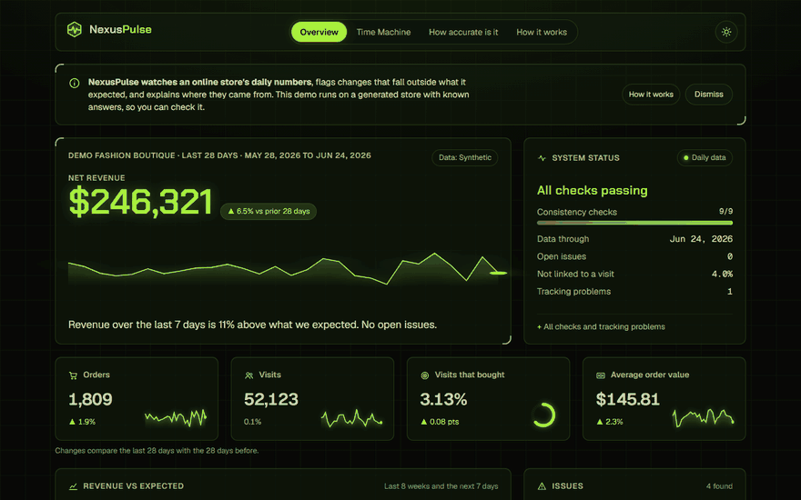
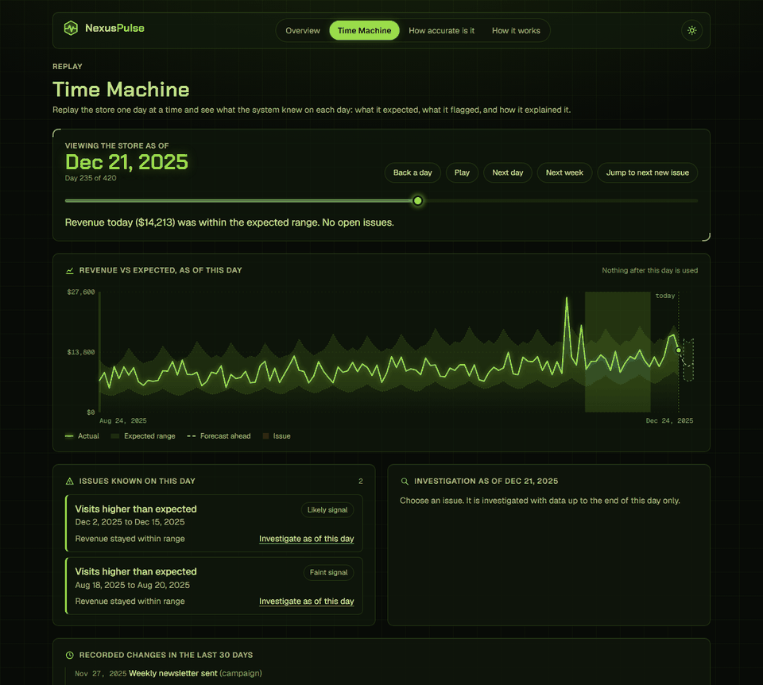
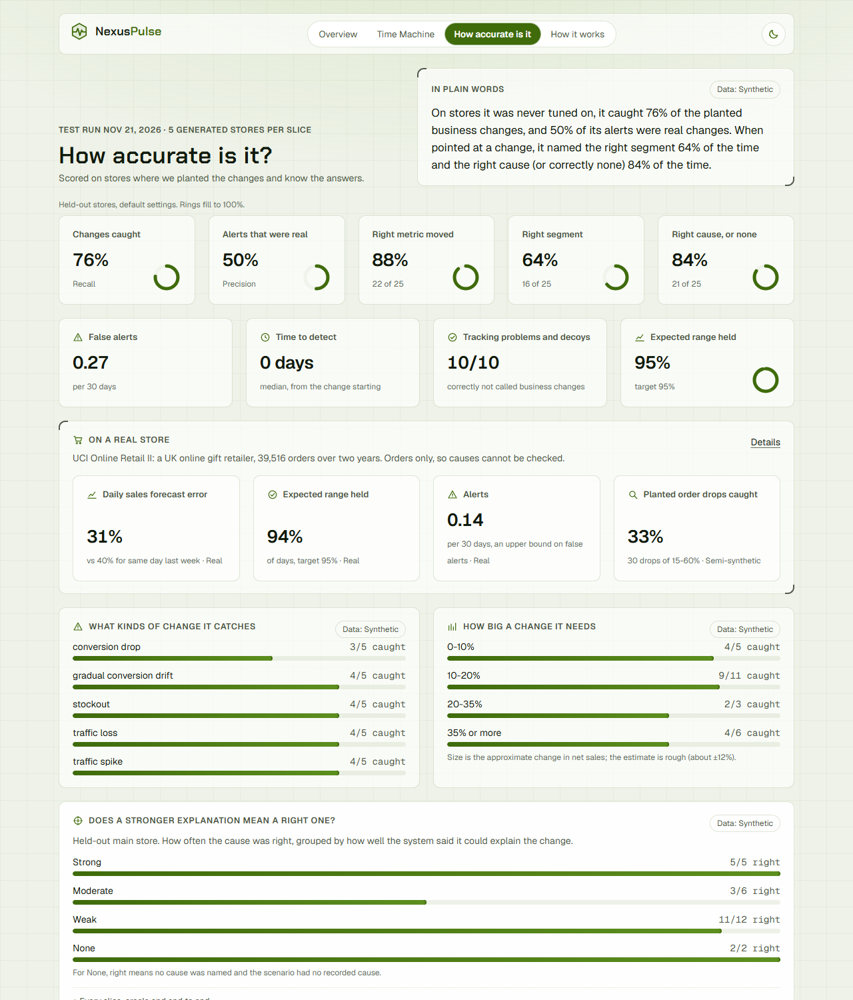

# NexusPulse AI

[](https://github.com/lyle-leif/NexusPulse-AI/actions/workflows/ci.yml)

An autonomous business intelligence system for small online stores. NexusPulse AI forecasts expected performance, detects unexpected changes, investigates where they occurred and what coincided with them, and writes traceable, evidence-backed reports. Every result shown here is measured on held-out data, and the limits are stated next to the results.

**Live demo (read-only):** https://lyle-leif.github.io/NexusPulse-AI/

The demo is a static build: pages and the Time Machine are precomputed, so it needs no server, database or language model. The full system runs locally.



## What it does

If revenue falls well below expectation, NexusPulse AI:

1. **Detects it** by comparing each day with a forecast issued before that day, for the whole store and separately for each channel, device, region and product category large enough to forecast. A change confined to one segment can be flagged even when the store total barely moves.
2. **Measures it** with an exact revenue bridge (attributed sales, timing, unattributed sales, discounts, refunds) and an exact Shapley breakdown over six factors: sessions, add-to-cart rate, cart-to-checkout rate, checkout-to-purchase rate, orders per converting session, and average order value.
3. **Locates it** by drilling into channels, devices, regions and product categories, separating traffic changes from rate changes.
4. **Checks what coincided with it**, such as deployments, price changes and campaigns recorded within 24 hours, with matching scope. It also rules out holidays and data-quality problems.
5. **Reports it** with typed findings (observed, measured breakdown, associated, hypothesis), an explanation-evidence level set by published rules, and a summary in which every sentence cites the findings it relies on.

The report never states that a recorded change caused a drop. A breakdown is not proof of cause, and the report says so.

## Core principles

1. **Python computes, the AI explains.** A language model never produces numbers or relationships.
2. **Observed, attributed, associated and hypothesized findings stay separate.**
3. **No invented probabilities.** Anomaly strength and explanation evidence use visible rules.
4. **Measured, not claimed.** Results come from held-out scenarios whose ground-truth labels the pipeline cannot read.
5. **Zero cost.** Free, open-source software only; the optional language model runs locally through Ollama.

## Results

All numbers below use the default configuration on **held-out** scenarios, written before tuning and generated from separate seeds. Each result is labeled Synthetic, Semi-synthetic or Real.

**On a real store** (UCI Online Retail II, a UK gift retailer, 39,516 orders; details [below](#external-dataset-uci-online-retail-ii)): daily sales forecasts are off by 31% on average versus 40% for "same day last week", the expected range holds on 94% of days, and the monitor raises 0.14 alerts per 30 days (Real). With planted order drops it catches 10 of 30 (Semi-synthetic).

### Detection (Synthetic, 5 stores per profile, 18 months each)

| Store | Recall | Precision | False alerts per 30 days | Median delay | Forecast band coverage |
|---|---|---|---|---|---|
| Main (about 1,500 sessions/day) | 0.76 | 0.50 | 0.27 | same day | 95% |
| Low volume (about 150 sessions/day) | 0.40 | 0.23 | 0.44 | 1 day | 96% |

Segment monitoring raised main-store recall from 0.48 to 0.76 (12 to 19 of 25 held-out scenarios) and precision from 0.41 to 0.50, at a cost of 0.03 more false alerts per 30 days (0.24 to 0.27). On the low-volume store no segment is large enough to forecast reliably, so it is monitored store-wide only and its numbers are unchanged. Segment series use only multi-day tests with a stricter threshold, ignore single extreme days, and skip the rebound after a recovered drop. These settings were chosen on development seeds; the held-out run was done once.

Scenarios that are not business changes were handled correctly in 10 of 10 cases on the main store and 7 of 10 on the low-volume store. These are broken tracking, which should be suppressed as a data-quality issue, and unrelated recorded changes, which should raise no alert. Robust fitting is the default. Masking past incidents out of the training data was tested and did not help, so it is off. The forecast band is drawn from the monitor's own earlier out-of-sample errors (2.5% to 97.5%), never narrower than the model band; before this it held on 91-94% of days.

### Investigation (Synthetic, main store)

| | Given the true incident window | From the monitor's own detections |
|---|---|---|
| Correct primary driver | 88% | 79% |
| Correct segment | 64% | 47% |
| Correct cause, or correctly "none" | 84% | 68% |
| Unrelated recorded change rejected | 4 of 5 | not applicable |

The right column covers the 19 scenarios the monitor caught, up from 12 before segment monitoring. The 7 added ones are mostly changes confined to one segment, which are harder to explain: the primary driver was right in 4 of them, so that rate fell from 92% to 79%. When explanation evidence was **Strong**, the named cause was right in 5 of 5 cases. On the low-volume store the segment is found only 16% of the time, because segment differences there are mostly noise.

### Reports (Synthetic, 25 held-out investigations)

| Narration mode | Passed first try | After one retry | Fell back to template | Seconds per report |
|---|---|---|---|---|
| Template only (default) | 25 | 0 | 0 | instant |
| Local llama3.1:8b | 17 | 5 | 3 | about 31 |
| Local qwen2.5:3b | 0 | 0 | 25 | about 20 |

Every AI-written sentence is checked: the findings it cites must exist, its numbers must match them, it may not claim more certainty than they support, its direction words must match the signs, and causal or overclaiming wording is blocked. If both attempts fail, the template text is shown. On 450 adversarial narratives (correct numbers, misleading meaning), the validator caught **78%**. The misses are mostly subtle semantic claims with no forbidden word, such as "shoppers lost interest". Rule-based checks reduce risk; they cannot guarantee meaning. Reports therefore default to the template, and the AI summary is optional.

### External dataset (UCI Online Retail II)

A real UK online gift retailer with 39,516 orders from December 2009 to December 2011 ([source](https://archive.ics.uci.edu/dataset/502/online+retail+ii), CC BY 4.0). It has orders only: no sessions, funnel, channels or change log. Only net sales and orders are monitored. No sessions are invented, and causes cannot be checked.

| | Value |
|---|---|
| **Real:** net sales forecast error (MAPE) | 30%, versus 40% for seasonal naive |
| **Real:** orders forecast error (MAPE) | 20%, versus 25% for seasonal naive |
| **Real:** forecast band coverage (net sales / orders) | 94% / 95% |
| **Real:** alerts in 503 monitored days | 3 (0.14 per 30 days), an upper bound on false alerts because the data has no labels |
| **Semi-synthetic:** injected order drops detected | 10 of 30 (7 of 16 for drops of 40-60%; 1 of 7 for 15-25%) |

The UK bank-holiday calendar matters. Without it the real data produces 19 alerts and net-sales error rises to 79%, mostly around the Christmas shutdown.

## Known limits

- Store-wide changes smaller than about 25% are still often missed, especially short ones. Segment monitoring catches more of them only when the change is concentrated in one channel, device, region or category.
- Low-volume stores are monitored store-wide only, and segment attribution there is unreliable.
- Cause matching is validated only on synthetic data. Real datasets with change logs are rare.
- The AI summary validator misses some misleading claims, which is why the template is the default.
- Synthetic stores are generated by this project. A model can do well on data shaped by the same assumptions, which is why the external dataset is included.

## Screens

Each screen opens with one plain sentence, generated from the data, that says what is happening. Technical detail (tables, rules, methods) sits in expandable sections below it. The UI uses issue for incident and "how well we can explain it" for evidence level.



- **Overview:** net revenue and its change with a 28-day trend; a system status panel (data date, consistency checks, open issues, orders not linked to a visit); tiles for orders, visits, conversion and average order value; revenue against the expected range with a 7-day forecast; open issues; a visits-to-revenue flow drawn to scale that highlights a step only when it weakened by more than 5%; sales by channel (donut and table, reconciled to the revenue bridge); and the revenue bridge.
- **Investigation:** a summary with citations next to an evidence meter, and a button that copies a plain-text summary for chat or email; segment bars showing where the change happened; a Shapley waterfall showing what moved; recorded changes around the start; the alternatives that were checked; and findings by status. Full tables are in expandable sections.
- **Time Machine:** replay the store one day at a time and see exactly what the monitor knew on each day. Each day's issue list is identical to that of a run stopped on that day, which a test checks. Investigations use no later data.
- **Evaluation:** headline scores as rings, recall by kind and size of change, and whether stronger evidence is right more often. Every section is labeled Synthetic, Semi-synthetic or Real.
- **How it works:** the four steps from store data to an explanation, each linked to the screen that shows it, plus where AI is and is not used and the known limits.

The interface uses a dark glass theme with lime accents and a light theme, switched with the sun/moon button. Glow is limited to chart lines, key numbers and active states; tables and long text sit on near-solid panels for readability. Phones get a bottom navigation bar.

| Evaluation | How it works | Phone |
|---|---|---|
|  |  |  |

Screenshots and animations are captured from the live demo with `python scripts/capture_media.py` (local Chrome, Node and Pillow, nothing downloaded).

## Technology

| Area | Choice |
|---|---|
| Web application | Next.js (TypeScript), Tailwind CSS |
| Analytics and pipeline | Python, pandas, statsmodels (ETS), NumPy |
| API | FastAPI |
| Database | PostgreSQL (Docker) |
| Language model (optional) | Ollama with a local open-weight model |

## Local setup

Requirements: Docker Desktop, Python (managed by `uv`), Node.js, and optionally Ollama.

```
py -m pip install --user uv
uv sync
docker compose up -d
uv run pytest
```

Run the app:

```
uv run python scripts/seed_demo.py
uv run uvicorn main:app --app-dir services/api --port 8000
npm --prefix apps/web install
npm --prefix apps/web run dev
```

The first page load computes all metrics and the timeline, which takes about 20 seconds; later loads are cached. For the optional AI summary, install Ollama and run `ollama pull llama3.1:8b`.

Reproduce the evaluation:

```
uv run python -m nexuspulse_eval.runner
uv run python -m nexuspulse_eval.runner mode=investigation
uv run python -m nexuspulse_eval.runner mode=narration
uv run python -m nexuspulse_eval.external
```

The external evaluation expects `data/external/online_retail_ii.zip` from the UCI link above.

Build and publish the static demo (with the API running):

```
uv run python scripts/export_demo.py
bash scripts/deploy_demo.sh
```

The development database uses host port 5433, and its credentials are for local use only.

## Documentation

| Document | Contents |
|---|---|
| [PRD.md](PRD.md) | Problem, goals, scope, requirements, success metrics, roadmap, risks |
| [ARCHITECTURE.md](ARCHITECTURE.md) | Components, data model, revenue decomposition, forecasting, investigation, reports, evaluation, reproducibility |

## Status

Version 1 roadmap: reliable data, measurable detection, evidence-backed investigation, verified AI reports, and demonstrable evaluation. All five steps are complete. Later ideas, such as a what-if simulator and conversational follow-up, are listed in the PRD.

## License

No license has been selected yet.
